<p align="center"><picture><source media="(prefers-reduced-motion: reduce)" srcset="./docs/assets/cover-motion-still.webp" /><source media="(prefers-reduced-motion: no-preference)" srcset="./docs/assets/cover-motion.webp" />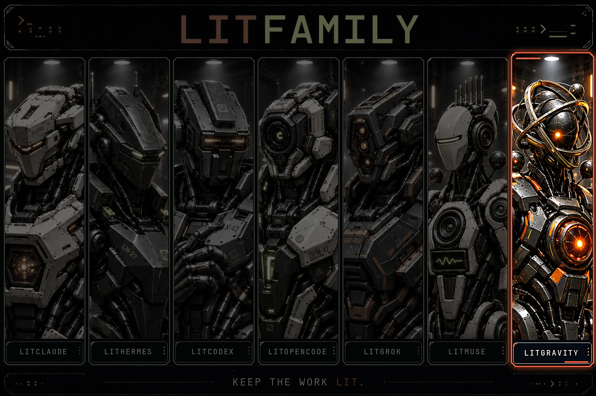</picture></p>

<h1 align="center">LitGravity</h1>
<p align="center"><strong>Keep the work lit.</strong></p>

<p align="center">LitGravity gives Google's Antigravity CLI (<code>agy</code>) the habit of planning before it edits, checking what it built, and leaving a handoff, so the next conversation starts where this one stopped. One npm command installs it as an agy plugin.</p>

<p align="center">
<a href="https://www.npmjs.com/package/@litfamily/litgravity"></a>
<a href="https://www.npmjs.com/package/@litfamily/litgravity"></a>
<a href="./LICENSE"></a>
<a href="https://github.com/wjgoarxiv/litgravity/stargazers"></a>
</p>

<p align="center"><a href="#install"> Install</a> &nbsp; <a href="#demo"> Demo</a> &nbsp; <a href="#safety-and-uninstall"> Update &amp; remove</a> &nbsp; <a href="#quick-start">Quick start</a> &nbsp; <a href="#what-you-can-make">What you can make</a> &nbsp; <a href="#what-you-get">What you get</a> &nbsp; <a href="#what-agy-limits-today">agy limits</a> &nbsp; <a href="./README_ko-KR.md">한국어</a></p>

> [!TIP]
> One npm command installs LitGravity as an agy plugin ([Install](#install)). Then start any agy prompt with `lit`, as [Quick start](#quick-start) shows.

## Demo

What ignition looks like, captured from the real hook and status line on this Mac: the typed prompt, the injected route note, and the status line carrying the lit-loop map.

<!-- demo-gif --><p align="center">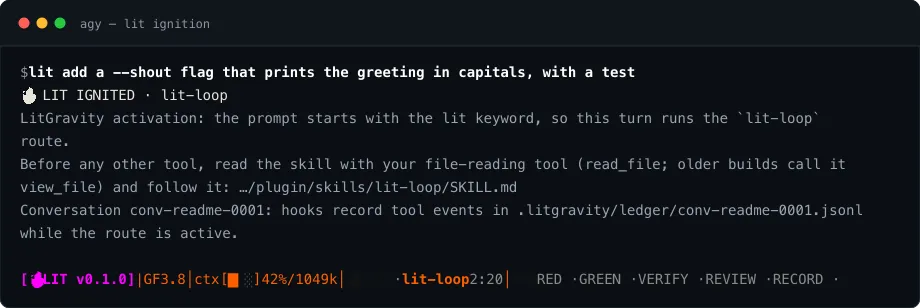</p>

## Quick start

1. [Install LitGravity](#install), then open agy in a project. Type `/skills` to see the LitGravity skills and `/hooks` to see the plugin's hooks.
2. Start a prompt with `lit`. The word after it picks the route, as the table below shows.
3. Approve a plan, then `lit start plans/<slug>.md` builds it row by row with tests.
4. Before you stop, `lit handoff`. Next time, `lit recap` reads where you were.

```text
you type    lit plan a tiny todo app
it does     reads the plan skill, explores the repo, writes plans/todo-app.md with ordered tasks and checks
it ends     "Plan saved. Run `lit start plans/todo-app.md` when you are happy with it."
```

| You type | What happens |
|---|---|
| `lit` | Runs the default loop, or picks up a plan you started with `lit start` |
| `lit` while its route is already active | A short "continues" note |
| `lit plan`, `lit review`, `lit research`, `lit debug`, `lit handoff`, `lit recap`, `lit brainstorm`, `lit korean` | Picks that route |
| `lit <other route>` | Switches |
| Any skill id as that word (`lit debugging`, `lit structural-search`) | Runs that skill; `/litgravity:<skill-id>` does the same as a slash command |
| `lit new` | Starts over |

`npx @litfamily/litgravity list` prints every skill with the words that reach it.

## What you can make

Each picture is a real output made on this Mac. The `lit-adhd` brief was drawn by its collector over three real agy conversations; the others were made by each skill's own engine from the skill's worked example. The deck, the P&ID, the schematics and the film come from skills that now live in wjgoarxiv-skills (see [Extensions](#extensions)); install those extensions and agy makes them the same way.

| Picture | Skill | What it shows |
|---|---|---|
| 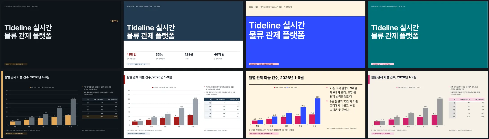 | `lit-pptx` | One deck in four of its tonalities. Charts and KPI rows stay native and editable, Pretendard is embedded, and each deck passed the gate for overflow, contrast and empty slides. |
| 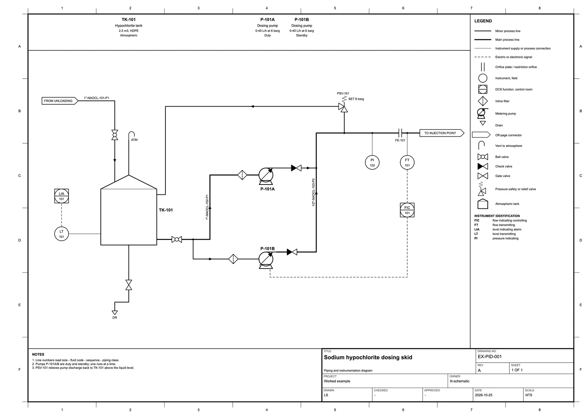 | `lit-schematic` | A P&amp;ID with ISA-5.1 tags, line numbers, a legend and a title block. Its checker passed: no text on a line, no line through a symbol, no loose end. |
| 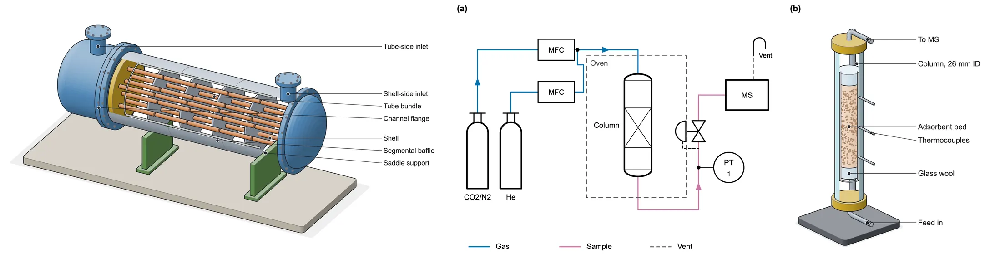 | `lit-schematic` | The same skill drawing equipment as an isometric cutaway and as a two-panel figure for a paper. |
| 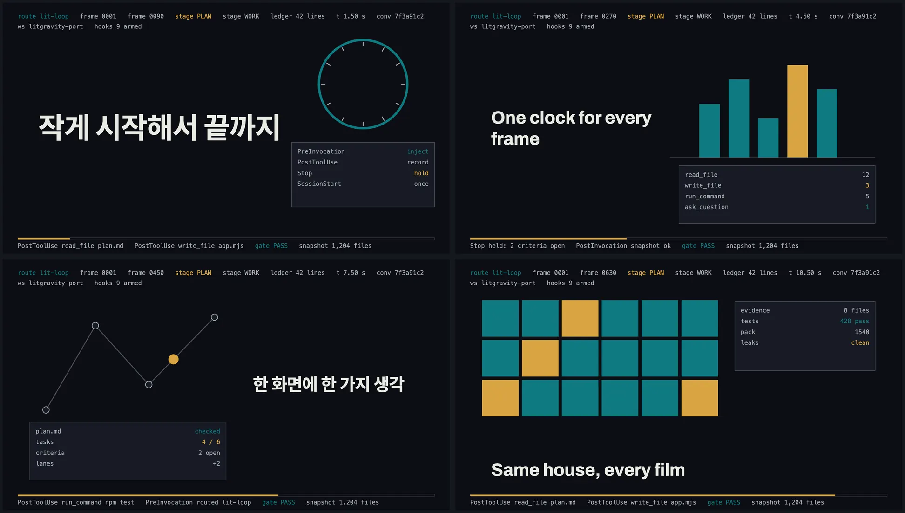 | `lit-typographic-motion` | Four frames of a 12-second film from a one-line Korean request. The skill wrote a treatment first, rendered it frame by frame with a sound bed, and its gate checked flashes, legibility and the loop. |
| 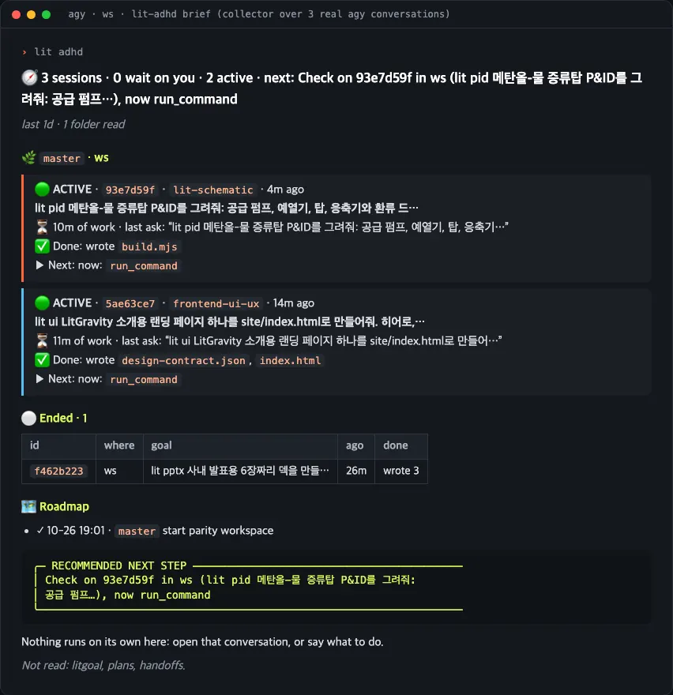 | `lit-adhd` | Type `lit adhd` after a scattered day for a KPI board. `lit adhd detail` adds the per-session brief shown here. |

The lit-adhd board shows the one thing to do now and exactly what to type, done and remaining milestones with progress bars, and reminders shaped as `thing → what to do`. The reminders cover a conversation waiting on you, uncommitted changes, lanes still running and a plan left for a week.

## Install

You need Node.js 20 or newer and the Antigravity CLI, signed in once. Run from any folder, and the check ends with `LitGravity: ready` when nothing is broken:

```bash
npx @litfamily/litgravity install
npx @litfamily/litgravity doctor
```

To update later, run the same `install` again; [Safety and uninstall](#safety-and-uninstall) lists every lifecycle command. To let a coding agent do the install, paste the prompt in the [reference](./docs/reference.md#let-a-coding-agent-install-it).

The installer shows every destination first and validates the plugin with `agy plugin validate` before and after copying. agy loads a plugin's hooks, skills and agents without a trust step, so there is nothing to approve. By default the plugin goes to `~/.gemini/config/plugins/litgravity`, so LitGravity is available in every project.

| Switch | What it does |
|---|---|
| `--scope project` | Copies to `./.agents/plugins/litgravity` for one project |
| `--dry-run` | Previews and writes nothing |
| `--yes` | Installs from a shell without a terminal (agent, CI), which otherwise only previews |
| `--no-agent-file` | Skips the global rule file for one run |
| `--status-line` | Adds the opt-in status line to agy's user settings, after a backup |

Every user-scope install also leaves one owned rule file at `~/.gemini/config/rules/litgravity.md`, because agy reads that folder at every session start. The rule stays short on purpose (the lit activation word, where plans and handoffs live, and the release freeze), so the ground rules hold before any skill loads. An interactive install asks first and a No stores the rule off, while `--yes` adds it; the [lifecycle table](#safety-and-uninstall) turns it off later or adds a project block.

`doctor` lists the installed copy, the validation result, the six hook events and a smoke run of each hook script, the global rule file, every skill and agent, the extensions with their install line, any old engine cache or stray saved copy, and the host programs the skills call.

The installer writes in a few places outside your project, and the map shows them. If the destination is a symlink, someone else's folder, or a copy you edited, it stops with `No files written.`; otherwise it copies the plugin, then writes the rule file and a small receipt. Everything else LitGravity leaves on disk is written later by your conversations, and the installer never changes your extension copies (it only reads the skill folders to tell you, once, when `extensions check` has something to show).

<p align="center">
  <picture>
    <source media="(prefers-color-scheme: dark)" srcset="./docs/assets/litgravity/diagrams/install-map.en.dark.png">
     extension copies and agy credential files).">
  </picture>
</p>

<p align="center">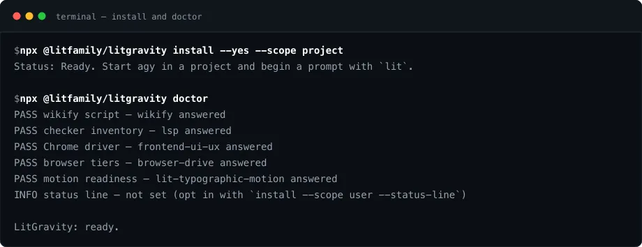</p>

## What you get

A lit turn runs the same routine through these parts. A bigger change gets a written plan first, the work is built row by row with tests under a goal record that outlives one conversation, and a second look reviews it before anything merges. Research shows its sources, documents and prose read clean, and the turn ends with a handoff the next conversation reads.

| Part | Contents | Role |
|---|---|---|
| 42 skills | 33 dense agy skills with their references and scripts, plus 9 stubs for moved skills | Plan, build, check, research, write, hand off |
| 11 agents | Child agents agy starts under their type names | Plan, execute, verify, review, Korean prose |
| 6 hooks | Run at session start, each turn, each tool call, and the stop gate | Route `lit`, hold unfinished turns, ledger every tool |

agy loads only the first 24,000 bytes of a `SKILL.md`, so each of the 33 dense skills, read on demand, keeps its references, scripts and templates in its own folder, with the long material in `references/` and the skill naming the file to open. The skill groups are loop and goals, ideas and planning, building, review and cleanup, research and knowledge, teams, prose, continuity and guidance, and tools, plus the nine stubs of the moved families (see [Extensions](#extensions)).

- **Host programs.** The skills call programs already on your machine: Python 3, Chrome or Chromium for browser work, ast-grep, ripgrep and the language checkers that `lsp` drives. `doctor` names what is missing and the command that installs it; LitGravity never installs software globally.
- **Agents.** agy starts them with `invoke_subagent` under their type name: lit-planner, lit-executor, lit-verifier, qa-runner, quality-reviewer, librarian-researcher, and five Korean prose agents (korean-style-analyzer, korean-prose-editor, meaning-preservation-auditor, native-flow-reviewer, polish-orchestrator). Reviewers and the Korean agents get read and search tools only.
- **Models.** `npx @litfamily/litgravity models` lists the models and effort tiers your agy offers, read from agy itself, so a model Google adds later shows up with no LitGravity update.

<details>
<summary>The six hook events</summary>

- SessionStart adds the LitGravity route list, an update notice and a pointer to a fresh handoff note, once per new conversation.
- PreInvocation is the `lit` router. agy has no prompt hook, so on the first model call of a turn the router reads the newest prompt from the transcript, applies the re-entry rule and injects one step that names the skill file to read.
- PostInvocation and Stop run the checks that agy cannot run in advance (see [the limits](#what-agy-limits-today)). Stop also holds an unfinished turn, as [Held turns](#held-turns-and-the-ledger) describes.
- PreToolUse refuses child agents that could write while lit-plan is active.
- PostToolUse writes one ledger line per tool call while a route is active, in `.litgravity/ledger/<conversation>.jsonl`, with key shapes redacted. A silent ledger means the hooks are not loaded.

</details>

### The status line

One row under the prompt shows where the work stands: the model and its effort tier, the context and quota gauges, the active route with its clock, and the map of that route with the current stage lit. The capture below is a real render from this Mac, before and after a `lit` prompt.

<p align="center">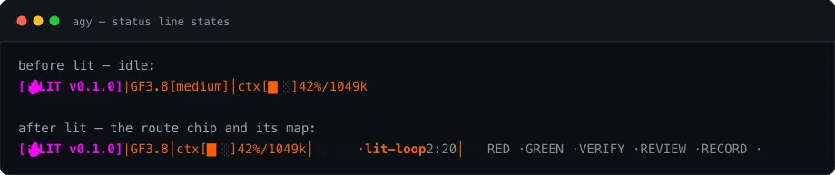</p>

`--status-line` at install turns it on. Its segments, colours, plain-text form and the looks for `lit adhd`, YOUR TURN, review lanes and DONE are in the [reference](./docs/reference.md#the-status-line).

## Extensions

LitGravity is the LitFamily core for agy, and it is complete on its own: planning, building, checking, research, handoffs and the `lit` router all ship in this package. The skills that make files (slides, Word documents, diagrams, schematics, figures, interfaces, films and README covers) each pull in their own engines, and together they used to be most of the package, while most people use one or two of them. They are now LitFamily extensions on one extension shelf, the wjgoarxiv-skills repository, where each skill has a folder written for agy.

Everything on the left ships in the npm package, and the core needs nothing on the right to plan, build, check, research or hand off. Install the extensions you use alongside LitGravity for the full LitFamily experience; leave the rest out and nothing in the core is missing.

<p align="center">
  <picture>
    <source media="(prefers-color-scheme: dark)" srcset="./docs/assets/litgravity/diagrams/core-extensions.en.dark.png">
    . An arrow labelled install <id> --yes runs from that folder to a card for litgravity extensions install with four numbered steps: check same-name skills and stop if any; move an old copy aside, whole, to ~/.gemini/extension-backups/<date>/; copy into the emptied folder; write a receipt inside the copy. An arrow labelled new copy + receipt runs on to agy user skills at ~/.gemini/config/skills/<id>, which answers as /<id>. Another arrow labelled if installed runs from the stubs to the same place. Below it, a card lists the other verbs, list, check, update, remove and prune-backups, each a plan only until --yes, and a note says that when the extension is not installed, the stub gives this command and the four hand lines and makes nothing.">
  </picture>
</p>

| Family in wjgoarxiv-skills | Extensions |
|---|---|
| `decks` | `lit-pptx` |
| `documents` | `lit-docx` |
| `figures` | `lit-diagram-drawer`, `lit-schematic`, `lit-scientific-visualization` |
| `design` | `frontend-ui-ux`, `visual-qa` |
| `video-covers` | `lit-typographic-motion`, `readme-studio` |

LitGravity keeps a short stub under each extension's old name, so `lit deck …`, `lit motion …`, `/litgravity:lit-pptx` and the rest still land somewhere useful. The stub hands the turn to your installed copy, or, when the extension is not installed yet, gives you the lines that install it and makes nothing. The installer says the same after every install or update, and the first agy conversation after it mentions it once.

The easiest way in is LitGravity's own `extensions` command. Every verb that changes anything prints its plan first and waits for `--yes`, so you can read exactly which folder moves where before it happens:

```bash
npx @litfamily/litgravity extensions install lit-pptx          # the plan only
npx @litfamily/litgravity extensions install lit-pptx --yes    # do it (--project: this workspace only)
```

| Verb | What it does |
|---|---|
| `install` | Backs up any old copy, then copies in the new one and its receipt |
| `list` | Shows each as installed (with receipt), not installed, receipt-less, or shadowed by a same-name skill |
| `update` | Fetches the source and reinstalls only the ones whose files changed |
| `remove` | Moves its own copy into the backups; a folder without a receipt is yours, so it refuses |
| `check` | Changes nothing; prints one fix line per duplicate, receipt-less copy or missing source |
| `prune-backups` | Shows the backups with their sizes and deletes them only with `--yes` |

A few rules keep the command safe and easy to drive:

- **Same-name check.** Before copying, `install` looks in every folder agy loads and stops with the path of any skill sharing the name. Your skill is never moved, and `--allow-shadow` installs anyway with a warning.
- **Backups.** An existing copy at the destination goes whole into a dated folder under `~/.gemini/extension-backups/` before the new copy goes in.
- **Source.** It keeps its own shallow clone of just the agy folders of wjgoarxiv-skills in `~/.cache/litgravity/extensions-src` (or reads a clone you already have with `--from <path>`), so there is nothing to clone by hand.
- **Several at once.** `--family <name>` and `--all` pick several. `npx @litfamily/litgravity extensions help` has the details, and `doctor` runs `check` and prints its summary.

Start a new conversation (or type `/skills reload`), and the skill answers as `/<id>`. To install by hand, the [reference](./docs/reference.md#install-an-extension-by-hand) gives the four shell lines, the workspace-only version, and how to update and remove a copy.

## How a lit turn runs

agy still runs the conversation and picks the model. LitGravity adds a routine in plain files you can read, so you stop re-explaining where you were and checking by hand what really works:

| What agy does | What lit adds |
|---|---|
| Starts fast from one typed line | A plan in `plans/` before the first edit |
| Forgets the last conversation once a long one fills its context | A handoff in `.litgravity/` the next turn reads |
| Calls it done when the model says so | Checks against the plan, marks the unchecked as unverified |

<p align="center">
  <picture>
    <source media="(prefers-color-scheme: dark)" srcset="./docs/assets/litgravity/diagrams/lit-route.en.dark.png">
    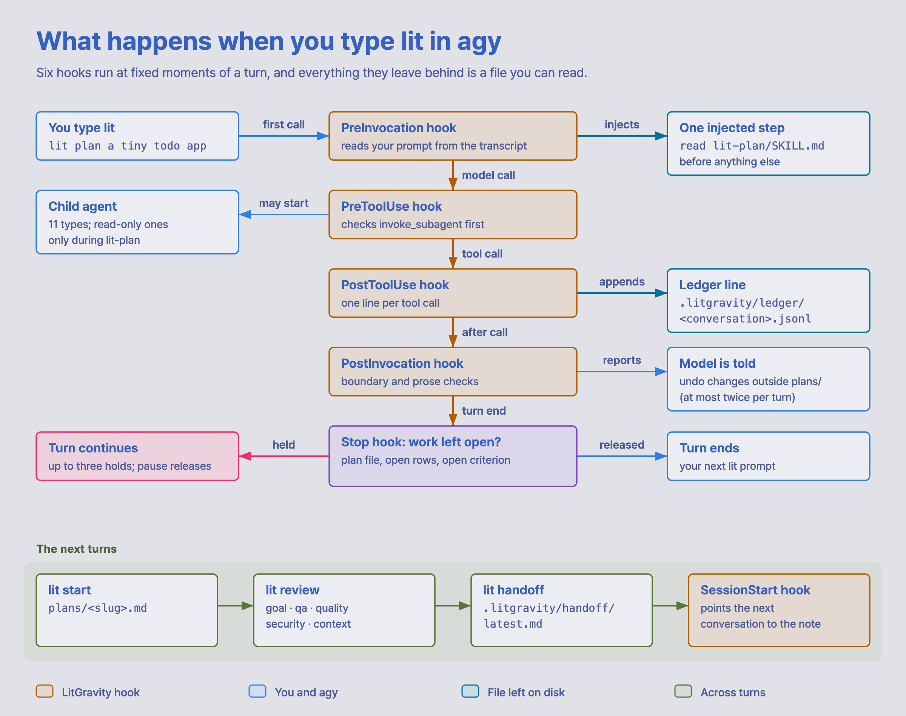.jsonl. The PostInvocation hook runs boundary and prose checks and tells the model to undo changes outside plans/, at most twice per turn. The Stop hook asks whether work is left open: held, the turn continues for up to three holds and pause releases it; released, the turn ends. Below, the next turns: lit start on plans/<slug>.md, lit review with five lanes (goal, qa, quality, security, context), lit handoff writing .litgravity/handoff/latest.md, and the SessionStart hook pointing the next conversation to that note.">
  </picture>
</p>

agy gives a plugin no hook on the prompt itself, so the PreInvocation hook steers from the first model call and the other hooks each watch one moment of the turn. Each moment leaves a file you can open afterwards (the plan, the ledger, the handoff note), and the next turns pick up from those files:

- **`lit start`** builds the plan, checked with tests and a look at the real surface. Whatever nobody could check is marked as unverified.
- **`lit review`** checks the result in five lanes.
- **`lit handoff`** writes `.litgravity/handoff/latest.md` with what was built, how it was checked and what is left. The SessionStart hook of your next conversation points to it.

### What a planning turn may do

`lit plan` turns are planning only. Most of that is asked, then checked afterwards, because agy offers no safe way to stop a write before it happens (see [the limits](#what-agy-limits-today)):

- The router tells the model to write only under `plans/` and `.litgravity/` and to keep the shell to plain read-only commands. Your own approval prompts still decide whether a write or command runs.
- After every model call and at the end of the turn, the boundary check compares the workspace with its state at the start of the turn. A file changed or removed outside `plans/` is reported and the model is asked to undo it, at most twice per turn. A command that changed nothing on disk leaves no trace for this check.
- Child agents are refused before they start unless they are read-only: lit-planner, librarian-researcher, lit-verifier, quality-reviewer and the Korean prose agents.

Route state lives outside the project, under `~/.local/state/litgravity/`, away from the files a planning turn is asked to touch. If that state is damaged, the child-agent limit and the plan gate stay on; if it goes missing, the hooks fall back to the route journal kept beside it.

### Held turns and the ledger

If you think in process plants, here is the same routine as one. Your prompt is the feed, the PreInvocation router is the header, and each route word opens the line to its vessel. I drew the stages as one train to keep it readable; in agy each of them is a separate `lit` prompt, usually in a later turn.

<p align="center">
  <picture>
    <source media="(prefers-reduced-motion: reduce) and (prefers-color-scheme: dark)" srcset="./docs/assets/litgravity/schematic/lit-plant.en.dark.png">
    <source media="(prefers-reduced-motion: reduce)" srcset="./docs/assets/litgravity/schematic/lit-plant.en.png">
    <source media="(prefers-color-scheme: dark)" srcset="./docs/assets/litgravity/schematic/lit-plant-loop.en.dark.webp">
    <source media="(prefers-color-scheme: light)" srcset="./docs/assets/litgravity/schematic/lit-plant-loop.en.webp">
    .jsonl. The lit-handoff unit sends latest.md off the sheet. A stream table lists, for each route, the skill, what leaves (plans/<slug>.md, plan rows ticked and tests run, findings with file:line first, .litgravity/handoff/latest.md) and whether the Stop hook holds it. In the animated version, dashes move along every stream.">
  </picture>
</p>

Every vessel bleeds a sample line into the ledger, and the handoff note leaves on the right for whichever conversation comes next. Between the vessels, the Stop hook's two analysers hold a turn while its work is open:

| Route | Held at the end while |
|---|---|
| lit-plan | no `plans/<slug>.md` exists yet |
| start-work | an approved plan has open rows |
| litgoal, lit-loop | a goal record has an open criterion |

A turn is held at most three times in a row without progress. Say `pause`, or write `BLOCKED at row N:`, `PAUSED at row N:` or `CANCELLED:` in the ledger, to release a hold. The capture below is the real hold from a planning turn that wrote nothing.

<p align="center">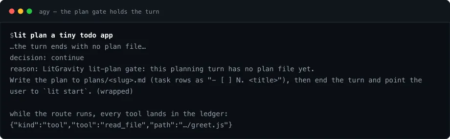</p>

## What agy limits today

These are the facts of agy 1.4.3, probed on a real install. LitGravity works inside them, and the [reference](./docs/reference.md#what-agy-limits-today-in-detail) gives each one in full.

- **No blocking before a write.** agy's PreToolUse hook has to decide every call it sees, so LitGravity checks file changes and prose after the fact. The one hard stop is a child agent that could write during a lit-plan turn.
- **Headless runs cannot ask.** In `agy -p`, a `run_command` or `write_file` that needs permission is denied and ends the run. The skills read first and report `BLOCKED` with the permission they need.
- **Seeing images.** agy's model reads a PNG through `read_file`, and every look step in the visual skills relies on that.
- **Starter Quota.** Every model call counts against your account's quota, so tests and probes use the free `agy plugin validate` and `/hooks`, `/skills`, `/agents`.
- **No compaction event, no slash-command folder, no MCP server from a plugin here.** Handoff notes, skills as commands (`/litgravity:<skill-id>`) and script subcommands take their place.
- **No lsp tool.** The `lsp` and `lsp-setup` skills drive language checkers from the command line instead.

## Safety and uninstall

Every lifecycle command previews with `--dry-run`, and hooks fail open: if one breaks, your conversation continues. Files that conversations created in your projects (`plans/`, `.litgravity/`) stay where they are.

| Task | Command |
|---|---|
| Install | `npx @litfamily/litgravity install` |
| Update | `npx @litfamily/litgravity install` (validates, replaces in place) |
| Global rule off or back on | `npx @litfamily/litgravity config agentFile off` (or `on`) |
| Project block | `npx @litfamily/litgravity agent-file project --dir <path>` (writes only the marked block into the repo's `AGENTS.md`) |
| Check | `npx @litfamily/litgravity doctor` |
| Extensions | `npx @litfamily/litgravity extensions list` (then `install`, `update`, `remove`, `check`, `prune-backups`) |
| Remove | `npx @litfamily/litgravity uninstall --yes` |

The installer writes only its own plugin folder, its data directory, its rule file and, when you ask, the status line key, and it never reads agy's credential files.

<details>
<summary>What each part may write, and what it leaves</summary>

- The installer writes only its own plugin folder, its data directory (`$XDG_DATA_HOME/litgravity`), the owned rule file in agy's global rules folder, and, when you ask, the status line key in agy's user settings, after a backup. It never reads agy's credential files. A rule file it did not write stops the install before the first write instead of being merged into.
- A symlinked, foreign or edited destination stops the install before the first write. To keep an edited copy, the installer gives a command that moves it to `~/.local/share/litgravity/saved/<scope>-<date>`. That folder is outside agy's plugins folder on purpose: agy loads every folder it finds there, so a copy saved beside the plugin would run as a second LitGravity. `doctor` warns about any such leftover. `--dry-run` never mutates.
- `extensions` writes only into agy's skill folder for the scope (`~/.gemini/config/skills/<id>` or `.agents/skills/<id>`), `~/.gemini/extension-backups/` and its own source clone in `~/.cache/litgravity/extensions-src`. Without `--yes` it only prints its plan. It never moves a same-name skill you keep elsewhere, never removes a folder without its receipt, and deletes only inside `~/.gemini/extension-backups/`, only with `prune-backups --yes`.
- Releases up to 0.1.8 cached engines under `~/.local/share/litgravity/runtime/` (`$XDG_DATA_HOME/litgravity/runtime/`), and the cache can take 150 MB or more. Nothing reads or writes there now, the extensions included, and `uninstall` leaves it, so delete that folder to free the space; `doctor` names it while it is there.
- Set `LITGRAVITY_HOOK_TRACE=<file>` before starting agy to log one line per hook call. It is off otherwise.

</details>

## Reference

[docs/reference.md](./docs/reference.md) keeps the material most readers need only once: [the status line](./docs/reference.md#the-status-line) in full, [a coding agent's install prompt](./docs/reference.md#let-a-coding-agent-install-it), [installing an extension by hand](./docs/reference.md#install-an-extension-by-hand), and [what agy limits today, in detail](./docs/reference.md#what-agy-limits-today-in-detail).

## Family

LitGravity is one of the seven LitFamily packages. Each one brings the same way of working to a single coding agent, and each installs and runs on its own: install the one for the agent you use, and it needs none of the others. [LitFamily](https://github.com/wjgoarxiv/litfamily) lists all seven and the agent each one is for.

The seven armored machines on the cover are those seven packages, and LitGravity is the orbit machine in the seventh bay. The cover is brand motion made with the LitFamily motion skill: drawn and animated artwork, with no agy session recorded in it. If your system asks for reduced motion, you see a still frame instead.

<p align="center">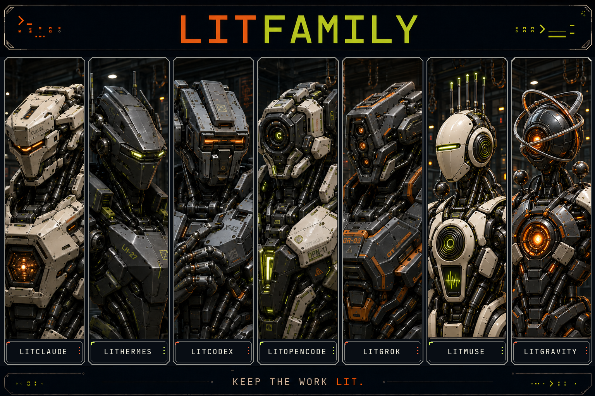</p>

## License

MIT. See [LICENSE](./LICENSE).

The LitGravity and LitFamily names and logos are covered by the [trademark policy](./TRADEMARK.md).
