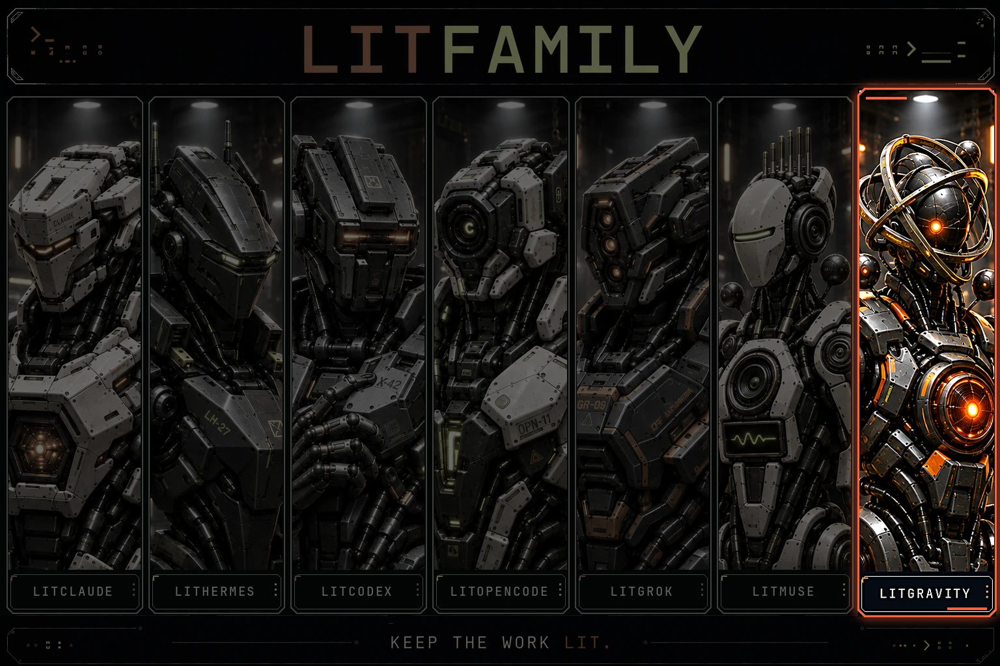
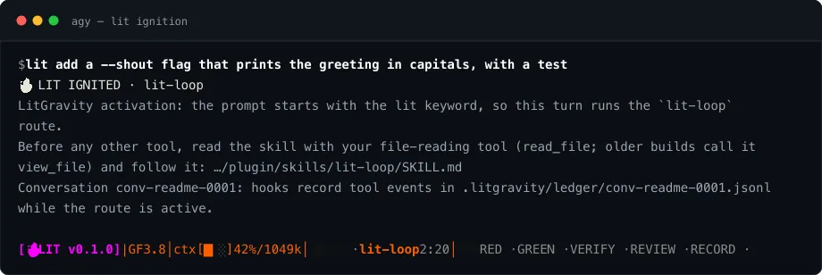
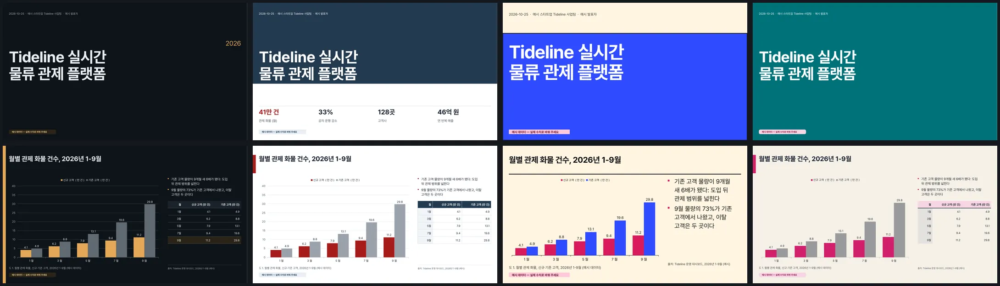
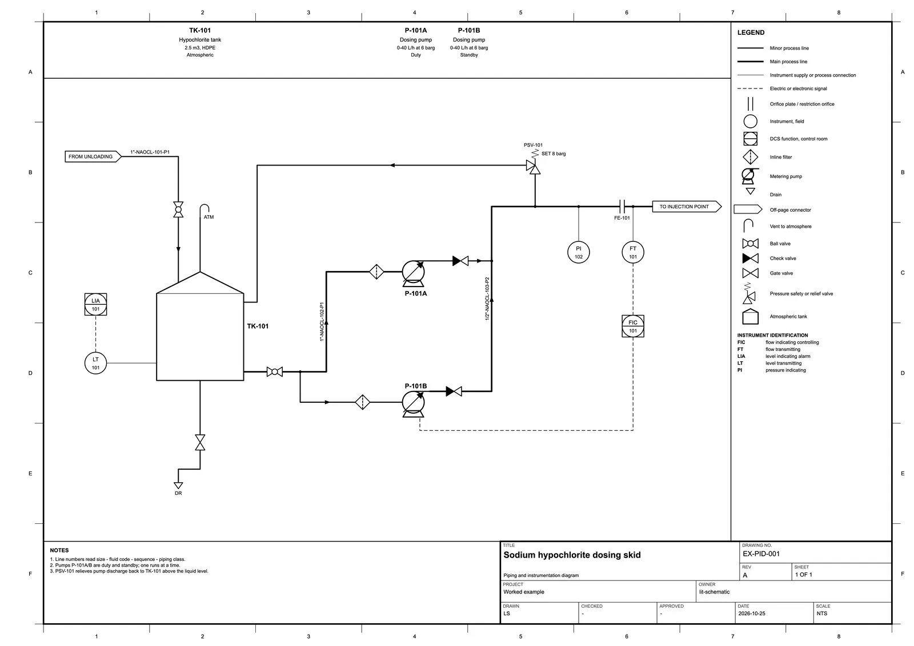
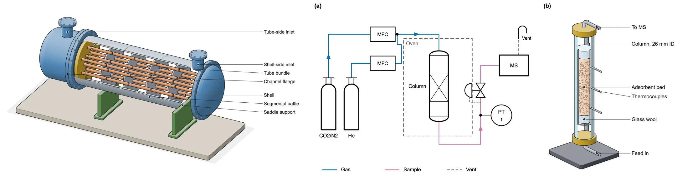
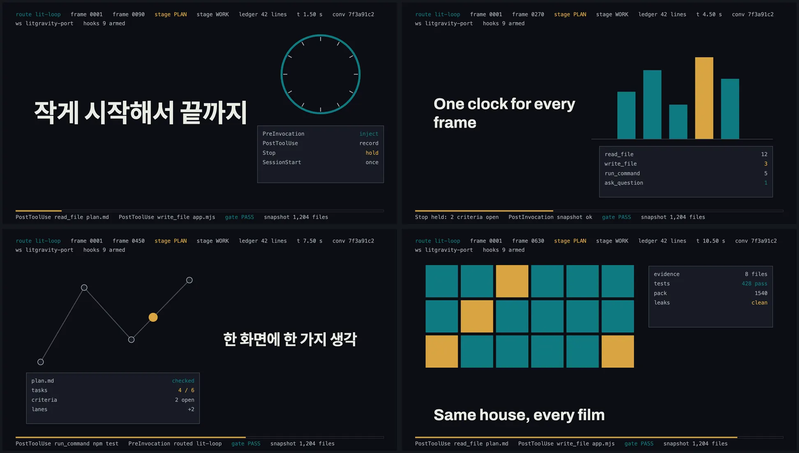
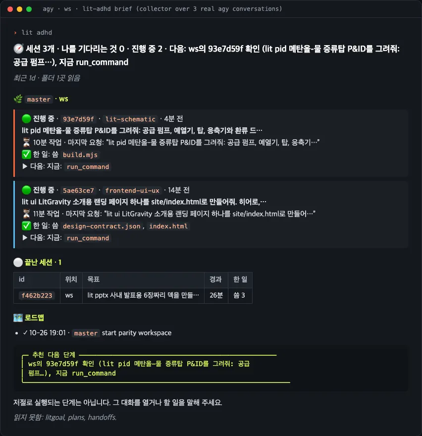
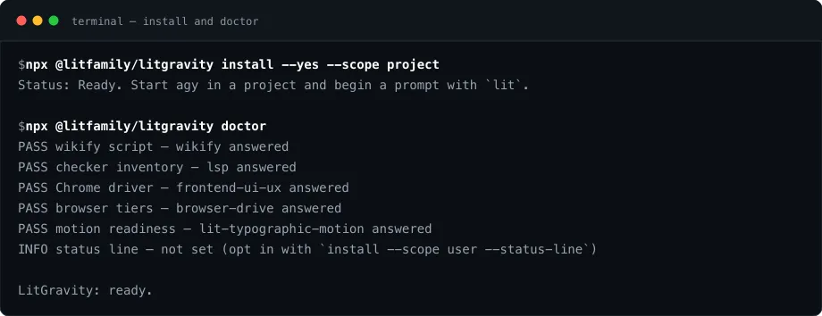
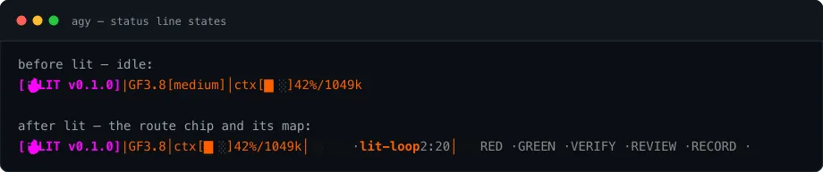
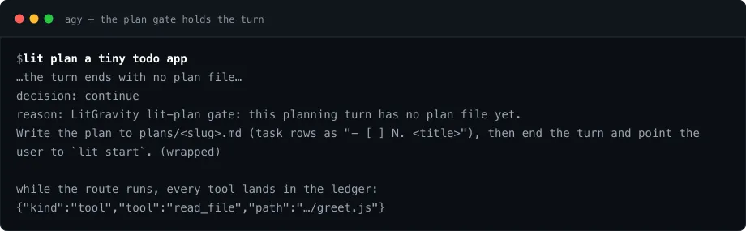

<p align="center"><picture><source media="(prefers-reduced-motion: reduce)" srcset="./docs/assets/cover-motion-still.webp" /><source media="(prefers-reduced-motion: no-preference)" srcset="./docs/assets/cover-motion.webp" /></picture></p>

<h1 align="center">LitGravity</h1>
<p align="center"><strong>Keep the work lit.</strong></p>

<p align="center">LitGravity는 Google의 Antigravity CLI(<code>agy</code>)에 일하는 습관을 붙여 줍니다. 고치기 전에 계획하고, 만든 것을 확인하고, 끝낼 때 인계 메모를 남깁니다. 그래서 다음 대화가 이번 대화가 멈춘 자리에서 바로 이어집니다. npm 명령 하나로 agy 플러그인으로 설치됩니다.</p>

<p align="center">
<a href="https://www.npmjs.com/package/@litfamily/litgravity"></a>
<a href="https://www.npmjs.com/package/@litfamily/litgravity"></a>
<a href="./LICENSE"></a>
<a href="https://github.com/wjgoarxiv/litgravity/stargazers"></a>
</p>

<p align="center"><a href="#설치"> 설치</a> &nbsp; <a href="#데모"> 데모</a> &nbsp; <a href="#안전과-제거"> 안전</a> &nbsp; <a href="#빠른-시작">빠른 시작</a> &nbsp; <a href="#만들-수-있는-것">만들 수 있는 것</a> &nbsp; <a href="#들어-있는-것">들어 있는 것</a> &nbsp; <a href="#지금-agy가-막아-두는-것">agy의 한계</a> &nbsp; <a href="./README.md">English</a></p>

## 데모

`lit`을 치면 무엇이 도는지, 이 Mac의 실제 훅과 상태 표시줄에서 가져왔습니다. 친 프롬프트, 끼워 넣은 경로 안내, lit-loop 지도를 단 상태 표시줄 순서입니다.

<!-- demo-gif --><p align="center"></p>

## 만들 수 있는 것

아래 그림은 모두 이 Mac에서 나온 실제 결과물입니다. `lit-adhd` 브리프는 실제 agy 대화 세 개를 수집기가 읽어 그렸고, 나머지는 각 스킬의 예제를 그 스킬의 엔진이 만든 것입니다. 대화에서 요청할 때 agy가 부르는 엔진과 같습니다.

| 그림 | 스킬 | 보여 주는 것 |
|---|---|---|
|  | `lit-pptx` | 한 덱을 네 가지 톤으로 만든 모습입니다. 차트와 KPI 줄은 편집할 수 있는 원본 그대로이고, Pretendard가 들어 있으며, 넘침·대비·빈 슬라이드 검사를 통과했습니다. |
|  | `lit-schematic` | ISA-5.1 태그, 라인 번호, 범례, 표제란을 갖춘 P&amp;ID입니다. 선 위 글자, 기호를 지나는 선, 끊긴 선이 없다는 검사를 통과했습니다. |
|  | `lit-schematic` | 같은 스킬이 장치를 등각 절단도로, 그리고 논문용 두 패널 그림으로 그린 예입니다. |
|  | `lit-typographic-motion` | 한 줄짜리 한국어 요청으로 만든 12초 영상의 네 장면입니다. 스킬이 먼저 트리트먼트를 쓰고, 사운드와 함께 한 프레임씩 렌더링한 뒤, 깜빡임·가독성·루프 검사를 거쳤습니다. |
|  | `lit-adhd` | 정신없던 하루 끝에 `lit adhd`를 입력하면 요청한 것, 쓴 것, 아직 돌고 있는 것, 실제로 할 수 있는 다음 단계 하나를 한 장으로 보여 줍니다. |

## 왜 LitGravity인가

agy는 시작이 빠릅니다. 한 줄 적으면 바로 일을 시작합니다. 문제는 그다음에 옵니다. 대화가 길어지면 컨텍스트가 차고, 다음 대화는 지난 대화가 알던 것을 모른 채 시작합니다. "끝났다"는 말도 모델이 그렇게 말했다는 뜻일 때가 많습니다. 결국 어디까지 했는지 다시 설명하고, 무엇이 실제로 돌아가는지 손으로 확인하게 됩니다.

LitGravity는 대화마다 따라갈 순서를 줍니다. 프롬프트를 `lit`으로 시작하면, 첫 모델 호출 전에 실행되는 훅이 어떤 LitGravity 스킬을 먼저 읽을지 agy에 알려 줍니다. 큰 변경은 먼저 `plans/`에 계획으로 적습니다. 작업은 그 계획에 맞춰 테스트와 실제 화면 확인으로 검증하고, 확인하지 못한 부분은 미확인으로 표시합니다. 끝내기 전에는 `.litgravity/handoff/`에 무엇을 만들었고 어떻게 확인했고 무엇이 남았는지 기록합니다.

```text
입력      lit plan a tiny todo app
동작      plan 스킬을 읽고 저장소를 살핀 뒤, 작업 순서와 확인 기준을 plans/todo-app.md에 씀
마무리    "계획을 저장했습니다. 괜찮으면 `lit start plans/todo-app.md`를 실행하세요."
```

대화를 돌리고 모델을 고르는 것은 여전히 agy이고, LitGravity는 그 주위에 따라갈 순서를 더합니다. 그 순서는 직접 읽을 수 있는 평범한 파일로 남습니다.

| agy가 하는 일 | lit이 더하는 일 |
|---|---|
| 한 줄을 치면 시작합니다 | 첫 편집 전에 `plans/`에 계획을 적습니다 |
| 지난 대화를 잊습니다 | 계획에 맞춰 확인하고, 확인하지 못한 곳은 미확인으로 표시합니다 |
| 모델이 그렇다고 하면 끝냅니다 | 다음 턴이 읽을 `.litgravity/` 인계를 남깁니다 |

## 설치

Node.js 20 이상과, 한 번 로그인해 둔 Antigravity CLI가 필요합니다. 터미널에서 실행하세요.

```bash
npx @litfamily/litgravity install
```

설치기는 먼저 쓸 위치를 모두 보여 줍니다. 기본값은 플러그인을 `~/.gemini/config/plugins/litgravity`에 복사하는 것이라 모든 프로젝트에서 LitGravity를 쓸 수 있고, `--scope project`는 한 프로젝트의 `./.agents/plugins/litgravity`에만 복사합니다. 복사 전후에 `agy plugin validate`로 플러그인을 검증합니다. agy는 플러그인의 훅, 스킬, 에이전트를 신뢰 단계 없이 불러오므로 따로 승인할 것이 없습니다. 그다음 결과를 확인합니다.

```bash
npx @litfamily/litgravity doctor
```

`doctor`는 설치된 사본, 검증 결과, 훅 이벤트 6개와 각 훅 스크립트의 실행 확인, 전역 규칙 파일, 스킬과 에이전트 전체, 각 엔진과 그 사전 설치 명령, 스킬이 부르는 호스트 프로그램, 엔진이 쓸 Python을 보여 줍니다. 깨진 곳이 없으면 마지막 줄이 `LitGravity: ready`입니다.

사용자 범위 설치는 `~/.gemini/config/rules/litgravity.md`에 LitGravity 전용 규칙 파일 하나를 남깁니다. agy가 매 세션 시작에 그 폴더를 읽기 때문입니다. 규칙은 일부러 짧습니다. lit 호출어, 계획과 핸드오프의 위치, 릴리스 동결만 담아서 어떤 스킬이 뜨기 전에 기본 규칙이 서도록 합니다. 대화형 설치는 먼저 묻고, No라고 답하면 규칙을 끈 채로 저장합니다. `--yes`는 규칙을 더하고, `--no-agent-file`은 한 번만 건너뛰고, `npx @litfamily/litgravity config agentFile off`는 언제든 규칙을 지웁니다. 저장소에는 `npx @litfamily/litgravity agent-file project --dir <경로>`로 맞는 프로젝트 관례를 넣습니다. `AGENTS.md`에 표시된 블록만 씁니다.

<p align="center"></p>

자주 쓰는 옵션: `--dry-run`은 미리 보기만 하고 아무것도 쓰지 않습니다. `--yes`는 터미널이 붙지 않은 에이전트나 CI 셸에서 설치를 허용합니다(그런 셸에서는 기본으로 미리 보기만 합니다). `--no-agent-file`은 전역 규칙 파일을 한 번만 건너뜁니다. `--status-line`은 agy 사용자 설정에 선택형 LitGravity 상태 표시줄을 추가합니다(기본값은 꺼짐).

상태 표시줄은 프롬프트 아래 한 줄이고, LitFamily 상태 표시줄 모양을 따릅니다. `[🔥LIT v…]` 표시 뒤의 모든 칸은 LitGravity의 불꽃 주황 한 가지 색입니다. 순서는 `model [effort] │ ctx [█▎░] 42%/1049k │ quota [▌░]28% ↻ 2h5m`이고, 그 뒤에 지금 도는 lit 경로를 분홍 `🔥 LIT` 칩과 시계로, 그 경로가 지도에서 어디쯤인지를 보여 줍니다. litwork와 lit-loop는 열린 기준의 증거 파일을 읽어 PIN, RED, GREEN, VERIFY, REVIEW, RECORD 중 하나를, 계획과 start-work는 interview, plan, work, review, done 중 하나를 계획 행 수와 함께 보여 줍니다. lit-team은 레인을 보여 주고, agy가 함께 넘겨주는 비용, 백그라운드 작업, 브랜치, 제목이 이어집니다. 컨텍스트와 쿼터 게이지는 70%에서 노랑, 90%에서 빨강이 됩니다. 터미널이 좁으면 덧붙인 정보부터 빠지고 경로와 컨텍스트 게이지는 남습니다. `NO_COLOR`는 색을 끄고, `LITGRAVITY_HUD_ASCII=1`은 모든 기호를 ASCII로 바꿉니다. agy에 이미 다른 상태 표시줄이 있으면 설치기는 손대지 않습니다. `install --status-line --replace-status-line`을 쓰면 원래 값을 저장한 뒤 바꾸고, `uninstall`이 그 값을 되돌려 놓습니다.

### 코딩 에이전트에게 설치 맡기기

아무 폴더에서 연 코딩 에이전트에 아래를 붙여 넣으세요.

```text
Google Antigravity CLI용 LitFamily 플러그인인 LitGravity를 설치해 줘.
공식 npm 패키지 @litfamily/litgravity만 써. 무엇이든 바꾸기 전에 계획을 보여 주고 내 승인을 기다려.
1. Node.js 20 이상과 agy가 PATH에 있는지 확인해 (`agy --version`).
2. 미리 보기: npx @litfamily/litgravity install --dry-run
3. 설치: npx @litfamily/litgravity install --yes
4. 확인: npx @litfamily/litgravity doctor 를 실행하고 마지막 줄을 알려 줘.
5. 무엇이 쓰였는지("Written:" 목록)와 설치기가 거부한 것이 있으면 알려 줘.
```

## 빠른 시작

1. 프로젝트에서 agy를 엽니다. `/skills`로 LitGravity 스킬을, `/hooks`로 플러그인의 훅을 볼 수 있습니다.
2. 프롬프트를 `lit`으로 시작합니다. `lit`만 쓰면 기본 루프가 돌고, 뒤에 오는 단어가 경로를 고릅니다. `lit plan`, `lit review`, `lit research`, `lit debug`, `lit handoff`, `lit recap`, `lit brainstorm`, `lit korean`이 있습니다. 스킬 id도 그 자리에 쓸 수 있고(`lit debugging`, `lit structural-search`), `/litgravity:<스킬-id>`는 스킬을 슬래시 명령으로 실행합니다.
3. 계획을 승인한 뒤 `lit start plans/<slug>.md`를 실행하면 계획의 행을 하나씩 테스트와 함께 만들어 갑니다.
4. 멈추기 전에 `lit handoff`. 다음에는 `lit recap`이 어디까지 했는지 읽어 줍니다.

`npx @litfamily/litgravity list`는 모든 스킬과 그 스킬에 닿는 단어를 출력합니다. 경로가 이미 켜진 상태에서 `lit`을 다시 쓰면 짧은 "이어 갑니다" 메모만 가고, `lit <다른 경로>`는 경로를 바꾸며, `lit`만 쓰면 `lit start`로 시작해 둔 계획을 이어받고, `lit new`는 처음부터 다시 시작합니다.

## 상태 표시줄

프롬프트 아래 한 줄이 지금 작업이 어디쯤인지 보여 줍니다. 모델과 강도, 컨텍스트와 쿼터 게이지, 시계가 달린 지금 경로, 현재 단계가 켜진 경로 지도 순서입니다. 아래 갈무리는 이 Mac에서 실제로 렌더링한 것으로, `lit`을 치기 전과 친 뒤입니다.

<p align="center"></p>

터미널이 좁아지면 덧붙는 정보부터 빠지고 경로와 컨텍스트 게이지는 남습니다. 색이 꺼진 곳에서는 같은 줄이 다음처럼 평문으로 나옵니다.

```text
[LIT] | GF3.8 | ctx [#--] 42%/1049k | [LIT] . lit-loop 2:20 | [PIN] = RED . - GREEN . - VERIFY . - REVIEW . - RECORD .
```

몇몇 순간에는 줄의 모양이 바뀝니다. `lit adhd`가 경로일 때는 칸마다 색이 다른 느린 무지개가 됩니다. `lit-rewind`로 부르든, 스킬 이름을 그대로 치거나 `/` 뒤에 치든, 모델이 스스로 스킬을 불러오든 똑같습니다. 턴이 질문, 승인 요청, BLOCKED 보고로 끝나거나 목표가 결정을 기다리면, 줄이 호박색이 되고 다시 입력할 때까지 `⚠ YOUR TURN · <이유>`를 띄웁니다. `lit review work`가 도는 동안에는 다섯 레인(goal, qa, quality, security, context)이 보고하는 대로 레인마다 제 색과 판정 표시를 달고 나타나며, `2/5` 같은 수도 함께 보입니다. 경로가 도는 사이 계획이나 목표가 끝나면 `✦ DONE ✦`이 20초 동안 뜹니다. agy는 줄을 다시 그리는 때를 스스로 정하므로 모든 모양은 멈춰 있는 그림이고, `NO_COLOR`에서도 표시 글자는 평문으로 남습니다.

## 들어 있는 것

모든 lit 턴은 같은 순서를 따릅니다. 큰 변경은 첫 편집 전에 계획으로 적습니다. 작업은 그 계획에 맞춰 테스트와 실제 화면 확인으로 검증합니다. 합치기 전에는 두 번째 눈이 검토합니다. 조사는 출처를 밝히고, 문서와 글은 깔끔하게 읽히며, 턴은 다음 대화가 읽을 인계 메모로 끝납니다. 아래 스킬, 에이전트, 훅, 엔진은 그 순서의 부품으로, 필요할 때 읽습니다.

**스킬 42개.** 각 스킬은 필요할 때 읽는 agy 스킬로, 필요한 참고 문서, 스크립트, 템플릿, 엔진을 자기 폴더 안에 갖고 있습니다. agy는 `SKILL.md`의 앞 24,000바이트만 불러오므로 긴 내용은 스킬의 `references/` 폴더에 두고, 스킬이 열 파일을 알려 줍니다.

| 부분 | 내용 | 역할 |
|---|---|---|
| 스킬 42개 | 참고 문서, 스크립트, 엔진을 담은 agy 스킬 | 계획, 구현, 확인, 조사, 작성, 인계 |
| 에이전트 11개 | agy가 타입 이름으로 시작하는 하위 에이전트 | 계획, 실행, 검증, 검토, 한국어 글 |
| 훅 6개 | 세션 시작, 매 턴, 매 도구 호출, 종료 게이트에서 실행 | `lit` 라우팅, 미완 턴 붙잡기, 도구 ledger 기록 |

스킬 묶음은 루프와 목표, 아이디어와 계획, 구현, 검토와 정리, 조사와 지식, 팀, 글, 이어가기와 안내, 화면과 문서, 문서와 그림, 영상과 커버, 도구이고, `npx @litfamily/litgravity list`는 모든 스킬과 그 스킬에 닿는 단어를 출력합니다.

문서, 다이어그램, README 커버, 그림, 모션 스킬은 버전이 고정된 엔진을 함께 싣습니다. 이름은 `office`, `diagram`, `readme`, `sciviz`, `motion`입니다. 각 엔진은 `~/.local/share/litgravity/runtime/<이름>`에만 설치됩니다. `npx @litfamily/litgravity runtime install all`(또는 이름 하나)로 한 번 설치하고, `runtime status`로 상태를 봅니다. 스킬은 엔진이 준비됐는지 먼저 확인하고, 없으면 agy에 설치 명령을 실행해 달라고 합니다. Python이 필요한 엔진은 알아서 쓸 수 있는 인터프리터를 고릅니다. 3.14보다 새로운 `python3`에는 고정된 패키지의 휠이 없으므로 `python3.14`, `python3.13`을 차례로 찾고, `LITGRAVITY_OFFICE_PYTHON`, `LITGRAVITY_SCIVIZ_PYTHON`, `LITGRAVITY_MOTION_PYTHON`이 있으면 그 값을 따르며, 맞는 인터프리터가 없으면 정확한 해결 방법과 함께 `BLOCKED`로 답합니다. 스킬은 이미 설치된 프로그램도 부릅니다. LibreOffice, pandoc, Poppler, Chrome 또는 Chromium, ffmpeg, libwebp, ast-grep, XeLaTeX, `lsp`가 돌리는 언어별 검사기가 그것입니다. 빠진 것과 설치 명령은 `doctor`가 알려 주며, LitGravity는 소프트웨어를 전역으로 설치하지 않습니다.

**에이전트 11개.** agy가 `invoke_subagent`로 타입 이름을 지정해 시작합니다. lit-planner, lit-executor, lit-verifier, qa-runner, quality-reviewer, librarian-researcher, 그리고 한국어 글 에이전트 5개(korean-style-analyzer, korean-prose-editor, meaning-preservation-auditor, native-flow-reviewer, polish-orchestrator)입니다. 검토용 에이전트와 한국어 에이전트는 읽기와 검색 도구만 받습니다.

**훅 이벤트 6개.**

- SessionStart는 새 대화가 시작될 때 한 번, LitGravity 경로 목록과 업데이트 알림, 최근 인계 메모 위치를 알려 줍니다.
- PreInvocation은 `lit` 라우터입니다. agy에는 프롬프트 훅이 없으므로, 한 턴의 첫 모델 호출에서 라우터가 대화 기록의 가장 최근 프롬프트를 읽고, 다시 진입 규칙을 적용한 뒤, 읽을 스킬 파일을 알리는 단계 하나를 끼워 넣습니다.
- PostInvocation과 Stop은 agy가 미리 실행할 수 없는 검사를 맡습니다(아래 한계 참고). Stop은 턴도 붙잡습니다. lit-plan 턴은 `plans/<slug>.md`가 생길 때까지, start-work는 승인된 계획에 열린 행이 있는 동안, litgoal과 lit-loop는 목표 기록에 열린 기준이 있는 동안 붙잡으며, 진전 없이 연달아 최대 세 번입니다. `pause`라고 말하거나 ledger에 `BLOCKED at row N:`, `PAUSED at row N:`, `CANCELLED:`를 적으면 풀립니다. 모션 턴은 스킬의 완료 검사가 마지막 렌더에서 통과하면 끝나고, 그렇지 않으면 두 번 붙잡은 뒤 "완료되지 않았다"는 알림을 답변에 넣게 합니다.
- PreToolUse는 lit-plan이 켜져 있는 동안 쓰기가 가능한 하위 에이전트를 거절합니다.
- PostToolUse는 경로가 켜져 있는 동안 도구 호출마다 `.litgravity/ledger/<대화>.jsonl`에 한 줄을 남깁니다. 키 모양의 값은 가립니다. ledger가 조용하면 훅이 불러와지지 않은 것입니다.

**모델.** `npx @litfamily/litgravity models`는 agy가 제공하는 모델과 추론 강도를 agy에서 직접 읽어 보여 줍니다. Google이 나중에 모델을 추가하면 LitGravity를 업데이트하지 않아도 목록에 나타납니다.

## 지금 agy가 막아 두는 것

아래는 실제 설치에서 확인한 agy 1.4.3의 사실입니다. LitGravity는 이 한계 안에서 동작하고, 중요한 곳에서는 그렇다고 말합니다.

- **쓰기 전에 막을 수 없습니다.** agy의 PreToolUse 훅은 보이는 모든 호출에 결정을 내려야 하고, 빈 답은 거부로 읽히며, `allow`는 사용자의 승인 확인을 건너뛰게 할 수 있습니다. 그래서 LitGravity는 파일 쓰기와 셸 명령이 일어나기 전에는 건드리지 않습니다. lit-plan 턴이 `plans/` 밖을 바꾸면 직후에 되돌리라고 알리고, 부정이나 완곡 표현이 겹겹이 쌓인 글은 쓰인 뒤에 보고합니다. 유일한 사전 차단은 lit-plan 턴에서 쓰기가 가능한 하위 에이전트입니다.
- **헤드리스 실행은 물어볼 수 없습니다.** `agy -p`에서 권한이 필요한 `run_command`나 `write_file`은 거부되고, 그 거부가 실행을 빈 답으로 끝냅니다(JSON의 `denied_actions`에 나옵니다). 작업 공간 안의 `read_file`은 동작합니다. 스킬은 먼저 읽고, 필요한 권한을 적어 `BLOCKED`로 보고합니다. 스크립트로 쓰려면 agy 설정에 허용 규칙을 넣거나 `--dangerously-skip-permissions`를 쓰되, 위험은 직접 감수해야 합니다. 헤드리스 실행이 스킬 파일을 읽어야 한다면 프로젝트 범위 설치(`--scope project`)를 쓰세요. 같은 확인에서, 실제 경로가 작업 공간 밖에 있는 플러그인은 `read_file`이 거부되었습니다.
- **이미지 보기.** agy의 모델은 `read_file`로 PNG를 봅니다. 시각 스킬의 모든 확인 단계가 이것에 기대고 있으며, 프롬프트에 한 번도 나오지 않은 단어만 담긴 그림으로 확인했습니다.
- **Starter Quota.** 모델 호출은 모두 계정 할당량에서 차감됩니다. 그래서 테스트와 확인은 비용이 들지 않는 `agy plugin validate`와 `/hooks`, `/skills`, `/agents`를 쓰고, LitGravity를 만드는 동안 실제 호출은 몇 번에 그쳤습니다.
- **압축 이벤트도, 슬래시 명령 폴더도, 플러그인의 MCP 서버도 아직 없습니다.** `lit-handoff`가 `.litgravity/handoff/latest.md`를 쓰고 새 대화가 그곳을 안내받습니다. 명령 역할은 스킬이 합니다(`/litgravity:<스킬-id>`). `wikify`는 스킬 안의 스크립트 하위 명령으로 돌아갑니다.
- **lsp 도구가 없습니다.** `lsp`와 `lsp-setup` 스킬은 언어별 검사기를 명령줄에서 돌립니다.

## 계획 턴이 할 수 있는 일

`lit plan` 턴은 계획만 합니다. agy에는 쓰기가 일어나기 전에 안전하게 멈출 방법이 없어서(위의 한계 참고), 대부분은 먼저 요청하고 나중에 확인하는 방식입니다.

- 라우터는 모델에게 `plans/`와 `.litgravity/` 아래에만 쓰고 셸은 읽기 전용 명령만 쓰라고 알립니다. 쓰기나 명령을 실제로 허락할지는 여전히 사용자의 승인 확인이 정합니다.
- 모델 호출이 끝날 때마다, 그리고 턴이 끝날 때 경계 검사가 턴 시작 때의 작업 공간 상태와 지금을 비교합니다. `plans/` 밖에서 바뀌거나 지워진 파일은 보고되고 되돌리라는 요청이 가며, 턴당 최대 두 번입니다. 디스크에 아무것도 바꾸지 않은 명령은 이 검사에 흔적을 남기지 않습니다.
- 하위 에이전트는 읽기 전용이 아니면 시작 전에 거절됩니다. 허용되는 것은 lit-planner, librarian-researcher, lit-verifier, quality-reviewer, 한국어 글 에이전트입니다.

경로 상태는 프로젝트 밖의 `~/.local/state/litgravity/`에 있어서, 계획 턴이 다루라고 안내받는 파일과 떨어져 있습니다. 그 상태가 손상되면 하위 에이전트 제한과 계획 게이트는 켜진 채로 남고, 사라지면 훅이 옆에 둔 경로 기록을 대신 읽습니다.

## 붙잡힌 턴과 ledger

기다려도 되는 턴이 있습니다. 계획 파일이 아직 없는 lit-plan 턴은 `plans/<slug>.md`가 생길 때까지 끝에서 붙잡히며, 진전 없이 연달아 최대 세 번입니다. start-work는 승인된 계획에 열린 행이 있는 동안, litgoal과 lit-loop는 목표 기록에 열린 기준이 있는 동안 기다립니다. `pause`라고 말하거나 ledger에 `BLOCKED at row N:`, `PAUSED at row N:`, `CANCELLED:`를 적으면 풀립니다. 아래 갈무리는 아무것도 쓰지 않은 계획 턴이 실제로 붙잡힌 모습입니다.

<p align="center"></p>

경로가 켜져 있는 동안 모든 도구 호출은 `.litgravity/ledger/<대화>.jsonl`에 한 줄씩 남고, 키 모양의 값은 가려집니다. 멈추기 전에 `lit handoff`를 치면 무엇을 만들었고 어떻게 확인했고 무엇이 남았는지 `.litgravity/handoff/latest.md`에 적히고, 다음 대화는 그 메모에서 시작합니다.

## 안전과 제거

- 설치기는 자기 플러그인 폴더, 데이터 디렉터리(`$XDG_DATA_HOME/litgravity`), agy 전역 규칙 폴더의 전용 규칙 파일, 그리고 요청했을 때 agy 사용자 설정의 상태 표시줄 키만 씁니다. 설정 파일은 먼저 백업합니다. agy의 인증 파일은 읽지 않습니다. 설치기가 쓰지 않은 규칙 파일은 합치지 않고 첫 쓰기 전에 설치를 멈춥니다.
- 심볼릭 링크이거나, 남의 파일이거나, 설치 뒤 수정된 대상은 첫 쓰기 전에 설치를 멈추고, 옮기는 명령을 알려 줍니다. `--dry-run`은 아무것도 바꾸지 않습니다.
- 훅이 하나 깨져도 대화는 계속됩니다.
- 엔진 캐시는 `~/.local/share/litgravity/runtime/`에 있습니다. `uninstall`은 캐시를 남기므로, 공간이 필요하면 그 폴더를 지우세요.
- agy를 시작하기 전에 `LITGRAVITY_HOOK_TRACE=<파일>`을 지정하면 훅 호출마다 한 줄씩 기록합니다. 지정하지 않으면 꺼져 있습니다.
설치부터 제거까지 세 명령으로 충분하고, 모두 `--dry-run`으로 먼저 미리 봅니다.

| 작업 | 명령 |
|---|---|
| 설치 | `npx @litfamily/litgravity install` |
| 업데이트 | `npx @litfamily/litgravity install` (검증하고 그 자리에서 교체) |
| 전역 규칙 끄기/켜기 | `npx @litfamily/litgravity config agentFile off` (또는 `on`) |
| 프로젝트 블록 | `npx @litfamily/litgravity agent-file project --dir <경로>` |
| 엔진 새로 받기 | `npx @litfamily/litgravity runtime install all` |
| 확인 | `npx @litfamily/litgravity doctor` |
| 제거 | `npx @litfamily/litgravity uninstall --yes` |

대화가 프로젝트에 만든 파일(`plans/`, `.litgravity/`)은 그대로 남습니다.

## 패밀리

LitGravity는 LitFamily 패키지 일곱 개 중 하나입니다. 각 패키지는 같은 일하는 방식을 코딩 에이전트 하나에 붙여 주고, 따로 설치되고 따로 동작합니다. 쓰는 에이전트에 맞는 것 하나만 설치하면 되고, 다른 패키지는 필요 없습니다.

커버의 장갑 기계 일곱 대가 이 일곱 패키지이고, 일곱 번째 칸의 궤도 기계가 LitGravity입니다. 커버의 모션은 LitFamily 모션 스킬로 만든 브랜드 연출입니다. 그려서 움직인 그림이라 실제 agy 세션을 녹화한 장면은 들어 있지 않습니다. 시스템에서 동작 줄이기를 켜 두었다면 정지 프레임이 대신 보입니다.

<p align="center"></p>

일곱 패키지와 각 패키지가 맡은 에이전트는 [LitFamily](https://github.com/wjgoarxiv/litfamily)에 모여 있습니다.

## 라이선스

MIT. [LICENSE](./LICENSE)를 보세요.

LitGravity와 LitFamily 이름과 로고는 [상표 정책](./TRADEMARK.md)을 따릅니다.
